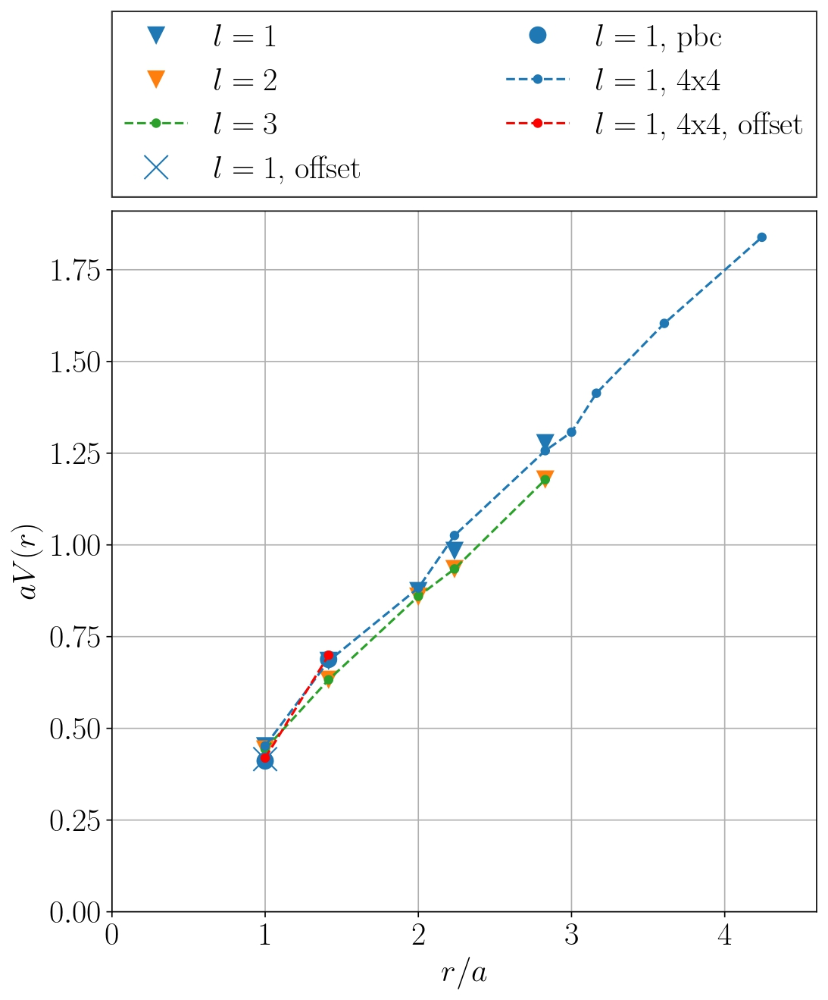

# Quark–antiquark potential in compact U(1) gauge theory

**Bachelor's thesis · Angelo Brade**

This project studies the potential between static charges using the Hamiltonian formulation of compact U(1) lattice gauge theory. A Python implementation constructs a truncated lattice Hamiltonian, restricts the configuration space using Gauss's law, and computes low-energy states with sparse matrix methods.

📄 **[Read the thesis](latex/Brade_Angelo_Bachelorarbeit.pdf)** · [Implementation](src/lattice.py) · [Results and discussion](latex/sections/results.tex)

## Research at a glance

- **Question:** How does the quark–antiquark potential change with separation, lattice size, electric-field truncation and boundary conditions?
- **Model:** A two-dimensional square lattice in the pure-gauge theory, with static, oppositely charged sources and optional periodic boundary conditions.
- **Method:** Construct the electric and magnetic contributions to the Hamiltonian in a physical basis, then find low-energy eigenstates using sparse exact diagonalization.
- **Results:** The thesis reports plaquette expectation values and a quark–antiquark potential that exhibits confinement in the studied setups. It compares the effects of lattice and truncation choices.

*Potential at coupling $g=1$ for several configurations. Unless otherwise indicated, the lattice is $3\times3$ with open boundaries. See the thesis for definitions and interpretation.*

## Computational approach

Electric-field values are truncated to make the problem finite. Gauss's law constrains the basis, and plaquette transitions are used to construct the magnetic operator. The resulting Hamiltonian is stored as a compressed sparse row matrix; SciPy's sparse eigensolver computes the low-energy states. The implementation also uses multiprocessing for matrix construction.

The state space grows rapidly even with these reductions. The thesis lists approximately $3.49\times10^9$ basis states for a $3\times3$ periodic lattice at truncation $l=4$. Calculations were performed on the University of Bonn's Marvin high-performance computing cluster; larger configurations require substantial memory and computation time.

## Repository guide

| Path | Contents |
| --- | --- |
| [`latex/Brade_Angelo_Bachelorarbeit.pdf`](latex/Brade_Angelo_Bachelorarbeit.pdf) | Completed thesis |
| [`latex/main.tex`](latex/main.tex) and [`latex/sections/`](latex/sections/) | Thesis source and chapters |
| [`src/lattice.py`](src/lattice.py) | Lattice construction, operators and diagonalization |
| [`src/main.py`](src/main.py) | Research scripts for potential and plaquette plots |
| [`src/backups/`](src/backups/) | Earlier code and exploratory tests |
| [`literature/`](literature/) | Reference material and third-party research code |

## Working with the code

The scripts import Python packages `numpy`, `scipy`, `sympy`, `matplotlib` and `primme`. Plot rendering also uses a LaTeX installation with the packages listed in [`src/main.py`](src/main.py). The repository does not pin dependency versions.

Run scripts from the `src` directory because their data and output paths are relative to it. For example, `make run` invokes `src/main.py`; its current main block runs several potentially expensive calculations and writes plots under `latex/images/`. It also saves cached lattices to `data/lattices.pickle`, so create the `data` directory first. Review the configurations in the script before running it. The historical `make test` target refers to a directory no longer present at that location.

## Thesis

Brade, Angelo. *Determination of the quark-antiquark potential in the Hamiltonian formulation of the compact U(1) gauge theory.* Bachelor's thesis, University of Bonn. The [thesis PDF](latex/Brade_Angelo_Bachelorarbeit.pdf) contains the theoretical background, implementation details, results and references.
